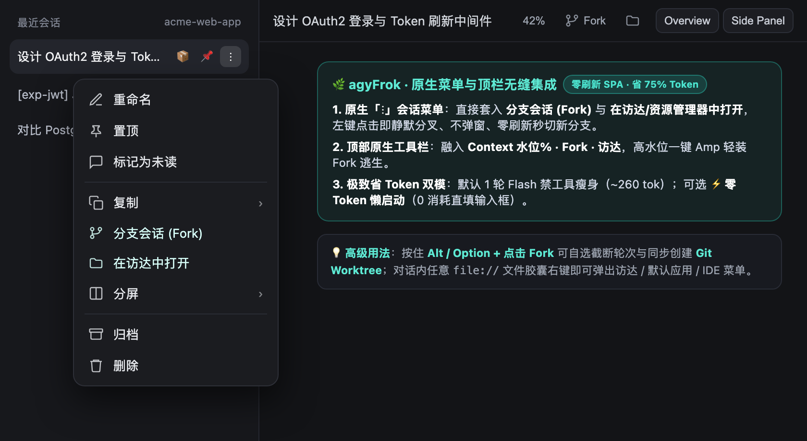
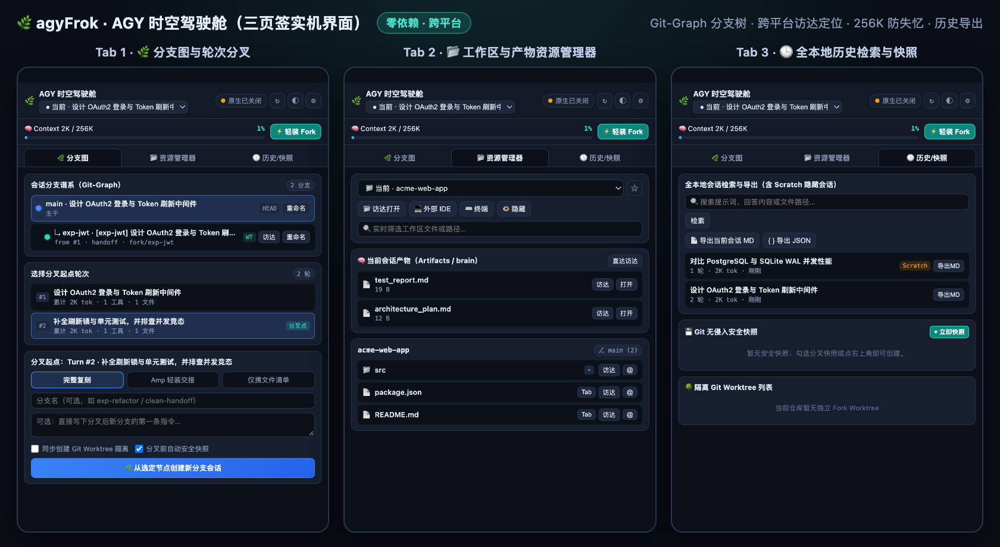
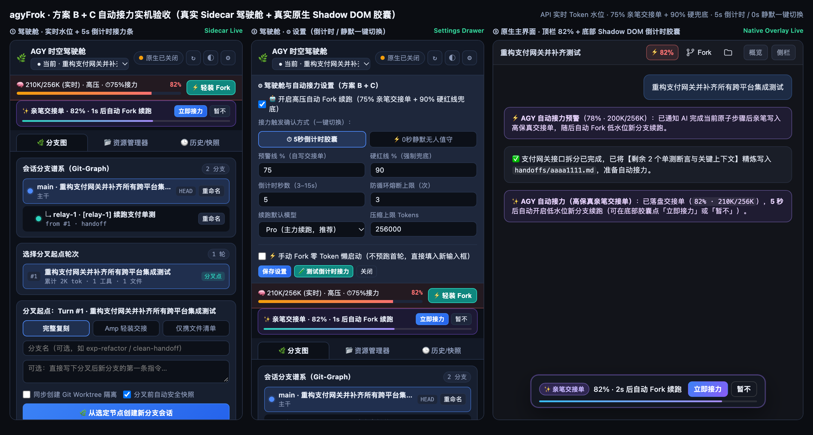

<div align="center">
  
  <h1>agyFrok · AGY 时空驾驶舱</h1>
  <p><strong>为 Google Antigravity 2.0 补齐原生静默 Fork 分支树 + 跨平台系统资源管理器（Finder / Explorer）+ 256K 防失忆闭环</strong></p>
  <p>
    <a href="https://github.com/jzPPP3333/agyFrok/actions/workflows/ci.yml"></a>
    
    = 20" />
    
    <a href="./LICENSE"></a>
  </p>
</div>

---

## 界面预览

### 1. 原生菜单与顶栏工具条无缝集成（零刷新 SPA · 静默一键 Fork）



### 2. 右侧辅助栏「AGY 时空驾驶舱」（三页签实机界面）



### 3. 上下文高压自动 Fork 续跑（方案 B + C · 亲笔交接单 + 倒计时/静默双模）



---

## 核心特性

### 🌿 静默一键 Fork & 可视化分支树（融合 Cursor / Claude Code / Codex / Pi / Amp）
- **像原生功能一样静默分叉（不弹窗、零刷新）**：
  - 直接套入 Antigravity 左侧会话 **`⋮` 下拉菜单**（`分支会话 (Fork)` + `在访达/资源管理器中打开`）与 **顶部标题栏工具条**；
  - 左键点击即静默分叉并自动继承原会话 `projectId`，通过 TanStack Router 无感 SPA 切页，**绝不触发页面重载闪屏**；
  - 按住 **`⌥/Alt`（或 `⇧/Shift`）+ 点击 Fork** 可呼出高级浮层自选截断轮次、切换模式或同步创建 **Git Worktree**。
- **极致省 Token 双模设计（相比传统全量复刻直降 75%~100% 启动消耗）**：
  - **默认超瘦身模式**：过滤只读 `read_file` 路径噪声只保留写改动文件，强制 1 轮 `flash` + 严禁工具调用极简确认（种子仅 ~260 tok，彻底杜绝首轮空转偷跑工具）；完整历史切片懒加载落盘按需读取；
  - **`⚡ 零 Token 懒启动` 开关**：在驾驶舱右上角 `⚙` 开启后，点 Fork 消耗 **0 Token / 0 次 LLM 请求**，无感打开同项目新对话并自动把精简上下文填入输入框，等你补上新需求回车再一起送出。
- **代码安全隔离**：支持分叉前自动保存**无侵入 Git 安全快照**（基于临时 `GIT_INDEX_FILE`，不污染 `git stash list`，随时看 Diff 与单文件恢复）及一键创建独立 **Git Worktree**。

### 📂 跨平台工作区 & 系统资源管理器（macOS / Windows / Linux）
- **一键在系统文件管理器高亮定位**：macOS `open -R` / Windows `explorer.exe /select,` / Linux `xdg-open`（原文件已删自动回退打开最近存在的上级目录）；
- **原生文件胶囊右键菜单 + `⌘/Ctrl + 单击`**：对话内任意 `file://` 链接右键即可在访达/资源管理器显示、默认应用打开、外部 IDE（VS Code / Cursor / Zed）打开、复制解码路径或 `@` 引用到输入框；
- **隐藏产物直达**：内置当前会话 `~/.gemini/antigravity/brain/<id>` 产物分组 + 工作区实时文件树（带 Git `M/A/?/D` 状态徽标）+ 代码/图片内联预览抽屉 + 目录收藏夹；
- **MCP App 聊天内联交付卡片**：支持通过 `show_files_inline` 在聊天流直接展示 Codex 风格可点击交付文件卡。

### 🧠 顺手闭环解决 Antigravity 高频痛点
- **上下文高压自动 Fork 续跑（方案 B + C 融合 · 原生 `hooks.json` + Sidecar 接力）**：
  - **真实 Token 水位监控**：直接读取 `transcript.jsonl` 中的官方 `input_tokens + cache_read_tokens` 实时占用（`/compact` 后自动回落，监控本身 0 Token 消耗）；
  - **75% 优雅亲笔交接单 + 90% 硬红线兜底**：达到预警线（默认 75%）自动通知 AI 完成当前原子步骤并亲笔写下 ≤300 字高保真交接单再自动 Fork 新分支无缝续跑；若 AI 未响应或触及 90% / `MAX_TOKEN_BUDGET_EXCEEDED`，钩子自动刹车止损并启动兜底接力；
  - **双模式一键切换**：在驾驶舱 `⚙` 设置里可随时切换 **`⏱ 5 秒倒计时确认胶囊`**（原生界面底部弹出可点「立即接力 / 暂不」）或 **`⚡ 0 秒静默无人值守`**（适配 `/goal` 长任务挂机）；内置单链防死循环熔断（默认上限 3 次）与接力前无侵入 Git 安全快照。
- **丢失历史找回 & 高保真导出**：只读扫描本地 `brain/` 全部会话（含侧栏消失的 `Scratch` 临时会话），支持关键词全文检索与一键导出 Markdown / JSON（含思考链与改动文件清单）。

---

## 快速安装（零 `npm install`）

### 方式一：发给 Antigravity 自动安装（推荐）

直接把下面这句话发给 Antigravity：

```text
请帮我安装插件 https://github.com/jzPPP3333/agyFrok 到 ~/.gemini/config/plugins/agy-fork-explorer（Windows 为 %USERPROFILE%\.gemini\config\plugins\agy-fork-explorer），运行 npm test 与 agy plugin validate --strict . 确认无误后给我打开管理页链接。
```

### 方式二：命令行一键克隆

- **macOS / Linux**：
  ```sh
  git clone https://github.com/jzPPP3333/agyFrok.git ~/.gemini/config/plugins/agy-fork-explorer
  chmod +x ~/.gemini/config/plugins/agy-fork-explorer/bin/run-node.sh \
           ~/.gemini/config/plugins/agy-fork-explorer/scripts/launch-with-cdp.sh
  ```
- **Windows (PowerShell)**：
  ```powershell
  git clone https://github.com/jzPPP3333/agyFrok.git "$env:USERPROFILE\.gemini\config\plugins\agy-fork-explorer"
  ```

安装后在 Antigravity 的 **Customizations → Plugins** 确认启用 `agy-fork-explorer`，即可在右侧辅助面板 `+` 菜单或左侧栏打开 **时空驾驶舱**，或在聊天中使用 `/fork-explorer`。

---

## 开启原生菜单与顶栏增强（可选，类 `agy-powertools` 体验）

本插件**不修改 Antigravity 应用本体、不读写任何账号凭据**；使用自带脚本以本地调试端口启动即可自动挂载原生 `⋮` 菜单、顶栏工具条与文件胶囊右键菜单（未开启时静默降级，驾驶舱与 MCP 卡片仍 100% 可用）：

- **macOS / Linux（支持 `--restart` 优雅重启）**：
  ```sh
  sh ~/.gemini/config/plugins/agy-fork-explorer/scripts/launch-with-cdp.sh --restart
  ```
- **Windows (PowerShell)**：
  ```powershell
  powershell -ExecutionPolicy Bypass -File "$env:USERPROFILE\.gemini\config\plugins\agy-fork-explorer\scripts\launch-with-cdp.ps1"
  ```

---

## 开发与测试

```bash
# 运行全部单元与集成测试（零外部依赖）
npm test

# 官方 Antigravity CLI 严格校验
npm run validate

# 独立启动驾驶舱本地预览（默认 http://127.0.0.1:4173）
npm run dev:cockpit
```

## License

[MIT](./LICENSE)
